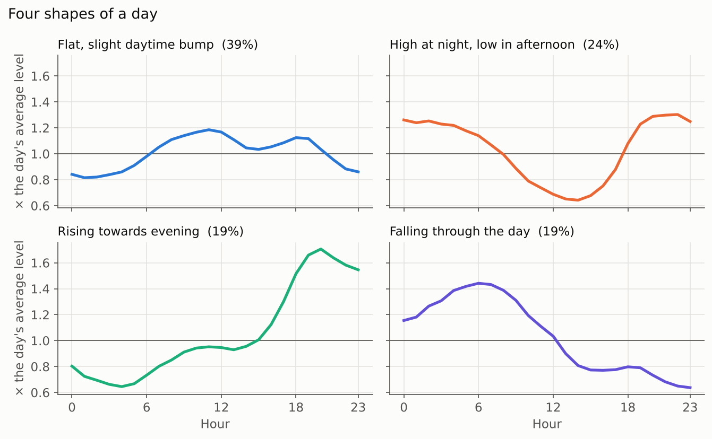

# Hanoi PM2.5 day types: what kinds of polluted days exist, and what conditions come with them?

A self-study **data analysis + data mining** project on hourly PM2.5 at the U.S. Embassy monitor in Hanoi (Ba Đình), 2016-01-30 → 2025-04-09.

**Question:** *What kinds of PM2.5 days does Hanoi have, and which weather / calendar / fire conditions tend to come with each kind?*

> Notebooks, comments and figure labels are in **Vietnamese** (English summary below). All results describe **associations, not causes**.

**Short read for non-specialists:** [What kinds of polluted days does Hanoi have?](article/article_en.md) (English) · [Bản tiếng Việt](article/bai_viet_vi.md)



## Data

| Source | What | Resolution | License |
|---|---|---|---|
| U.S. Department of State AirNow (U.S. Embassy Hanoi), via the **OpenAQ** open archive on AWS S3 (locations 2539, 7441) | PM2.5 | hourly | U.S. Government work, tagged *US Public Domain* on OpenAQ |
| **Open-Meteo** Historical Weather API (ERA5 / ERA5-Land reanalysis, Copernicus) | temperature, humidity, rain, pressure, cloud, radiation, wind, boundary-layer height | hourly, ~25 km grid | CC BY 4.0 |
| **NASA FIRMS** (VIIRS S-NPP 375 m, MODIS 1 km), Vietnam country files | active-fire counts and FRP in 3 regions around Hanoi | daily | NASA open data, no restrictions, citation requested |
| Calendar | Lunar New Year (Tết), 3 COVID-19 lockdown periods in Hanoi (sources cited in notebook 02) | daily | — |

See [DATA_ATTRIBUTION.md](DATA_ATTRIBUTION.md) for required credits and citations. The processed data in this repo is released under **CC BY 4.0** (the most restrictive upstream license).

Clean data: 80,592 hours; 2,322 "complete" days (≥ 18/24 valid hours); 2,230 days used for clustering. Coverage is uneven: 2019, 2021–2023 miss several months and 2025 stops on 9 April.

## Method

| Step | Notebook | Type |
|---|---|---|
| Collect, clean, time zone (Asia/Ho_Chi_Minh), quality flags | `phase1/01_thu_thap_lam_sach.ipynb` | data preparation |
| Add fire counts, Tết, lockdowns; daily table with 24-h curves | `phase1/02_bien_bo_sung.ipynb` | data preparation |
| EDA: distribution (log), trend, season, diurnal cycle, WHO/QCVN exceedance, Spearman within season | `phase2/03_eda.ipynb` | **analysis** |
| Clustering of daily **shape** (`log PM2.5 − daily mean log`, k-means k=4; checked with silhouette, BIC, bootstrap ARI, Ward, GMM, DTW) × 3 **level** tiers (≤25, 25–50, >50 µg/m³) | `phase2/04_clustering.ipynb` | **mining** |
| Association rules (FP-Growth, within season; lift ≥ 1.3, productive rules, Fisher + Benjamini–Hochberg; robustness by year and 2016–20 → 2021–25 holdout; compared with a decision tree) | `phase2/05_association_rules.ipynb` | **mining** |
| Anomaly detection: sensor-fault flags; contextual anomalies = residual from a weather-only HistGradientBoosting model (GroupKFold by year, R² 0.64), robust z ≥ 2.5; episodes; Isolation Forest; check against news | `phase2/06_anomaly.ipynb` | **mining** (with ML as a tool) |
| Sequential patterns of day types: transition matrices by season; Markov order 0/1/2 compared by leave-one-year-out log-loss; contiguous 2–4-day patterns vs independent and Markov-1 baselines (1,000 simulations, WINEPI-style); PrefixSpan on 139 high-PM episodes vs same-season control windows; robustness by year and 2021–25 holdout | `phase2/07_sequences.ipynb` | **analysis** + **mining** (ML-style evaluation) |

## Main findings (associations)

- **Exceedance:** daily PM2.5 was above the WHO 2021 guideline (15 µg/m³) on ~90–99% of complete days each year, and above the Vietnamese standard QCVN 05:2023 (50 µg/m³) on ~25–44%.
- **Four day shapes** form a continuum rather than clean groups (silhouette ≈ 0.14), but k=4 is stable (bootstrap ARI 0.81):
  - **U – high at night, low in the afternoon** (24%): dry days, large diurnal temperature range, low night boundary layer; most common Oct–Nov; often persists several days.
  - **Rising toward evening** (18%): wind weakens in the evening; tomorrow is typically ~32% dirtier — looks like the *start* of an episode.
  - **Falling through the day** (19%): wind strengthens in the evening, more humid; tomorrow typically ~21% cleaner — the *end* of an episode.
  - **Flat with a daytime bump** (39%): near-normal conditions; dominant Feb–May and during Tết.
- **Level** (within the same season) goes with dispersion: **high** days with weak wind, low boundary layer, no rain, large temperature range (plus north-easterly wind in winter); **low** days with rain (especially morning rain) and strong wind. Example: in winter, *large temperature range + weak wind → high level* holds on 95% of matching days vs a 54% base rate.
- 301 within-season rules pass the filters; 257 are robust across years and in the 2016–20 → 2021–25 holdout. Shape is much harder to predict than level (decision tree balanced accuracy 0.41 vs 0.79).
- **Sequences (notebook 07):** level is persistent (high → high on 78% of winter/autumn days), shape much less so. Knowing today's type cuts next-day log-loss by 19% for level but only 2.6% for shape; adding yesterday (order 2) does *not* help out of sample, and no 3–4-day pattern beats a first-order Markov baseline, i.e. no evidence of memory beyond one day with this much data.
  - **Episodes open with "rising" and close with "falling":** the day before a run of high days is *Rising toward evening* in 47% of episodes, and the last high day is *Falling through the day* in 47% (both lift ≈ 2.5 vs the same season; stable in 9–10 of 10 years, all four seasons and the 2021–25 holdout). The middle of an episode has no fixed shape. Because shapes are computed per calendar day (00–23 h), this mostly says episodes at this site tend to **start in the evening/night and clear during the day**.
- **Anomalies:** 17 days flagged as likely sensor faults (fixed upstream). The weather-only model recovers known effects it was never told about: Tết days ≈ 12% below expectation, lockdowns ≈ 5% below, weekends ≈ 0 (negative control). 22 days are much dirtier than the weather explains; October has the highest share. 2020-07-28 matches a same-day news report.

## Limitations

- **One monitor** (Ba Đình) does not represent the whole city.
- Weather is **reanalysis** (~25 km), not measured at the site; boundary-layer height is missing for 2024-01-01 → 2024-07-01.
- FIRMS country files only include fires **inside Vietnam**, and satellites cannot see through cloud.
- Hourly time stamps were shifted −1 h (OpenAQ end-of-hour → start-of-hour); checked with New Year fireworks, 3 of 4 years agree.
- Uneven yearly coverage; do not compare cluster shares across years.
- Thresholds (cluster k, level tiers, rule filters, |z| ≥ 2.5) are project choices; rules describe sub-groups, not laws.
- Embassy data are preliminary monitoring data, not officially validated.

## Reproduce

```bash
python -m venv .venv && source .venv/bin/activate     # Windows: .venv\Scripts\activate
pip install -r requirements.txt

python run_pipeline.py            # extract the raw cache and run notebooks 01 -> 07 (offline, ~in place)
python run_pipeline.py --list     # show the steps
python run_pipeline.py --from 04  # resume from a step (needs outputs of earlier steps)
python run_pipeline.py --only 07  # run one notebook
python run_pipeline.py --regen    # rebuild notebooks from the _make_notebook_*.py scripts, then run
python run_pipeline.py --online   # re-download FIRMS instead of reusing firms_daily.csv
```

`run_pipeline.py` works the same on Windows, macOS and Linux. It runs each notebook from its own folder and saves the outputs in place. Manual equivalent:

```bash
cd phase1
mkdir -p data/raw && tar xzf data/raw_openaq_2539_7441.tar.gz -C data/raw && tar xzf data/raw_openmeteo.tar.gz -C data/raw
FIRMS_OFFLINE=1 jupyter nbconvert --to notebook --execute --inplace 01_thu_thap_lam_sach.ipynb 02_bien_bo_sung.ipynb
cd ../phase2
jupyter nbconvert --to notebook --execute --inplace 03_eda.ipynb 04_clustering.ipynb 05_association_rules.ipynb 06_anomaly.ipynb 07_sequences.ipynb
```

- Tested 2026-11-23 on Python 3.13 with scikit-learn 1.9.1: `run_pipeline.py --regen` runs 01 → 07 in about 2 minutes offline. Notebooks 01–05 and 07 reproduce the published tables; notebook 06 (HistGradientBoosting, Isolation Forest) shifts slightly with the scikit-learn version (e.g. 21 vs 22 "dirtier than expected" days), so pin versions if you need identical numbers.
- Phase 2 reads `../phase1/data/clean/`; override with the env var `HANOI_AQ_DIR`.
- `FIRMS_OFFLINE=1` (default in `run_pipeline.py`) reuses `phase1/data/clean/firms_daily.csv`; without it notebook 02 downloads FIRMS country files (no key needed).
- If numba complains about its cache on a network drive, set `NUMBA_CACHE_DIR` to a local folder (`run_pipeline.py` does this). `tslearn` is optional (DTW comparison is skipped without it).
- Network hosts used when not running offline: `openaq-data-archive.s3.amazonaws.com`, `archive-api.open-meteo.com`, `firms.modaps.eosdis.nasa.gov`. Open-Meteo has a daily request limit per IP.

## Reusing the pipeline in another project

Every notebook is generated by a plain Python script next to it (`phase1/_make_notebook.py`, `_make_notebook_02.py`, `phase2/_make_notebook_03.py` … `_make_notebook_07.py`). The scripts are the source of truth: edit a script, then `python run_pipeline.py --regen --only 0X` (or `python _make_notebook_0X.py 0X_name.ipynb` inside the folder) to rebuild the notebook.

To point the pipeline at another city or monitor:

1. **Phase 1**: in `_make_notebook.py` change `OPENAQ_LOCATIONS`, `LAT, LON` (used for Open-Meteo), `TZ` and the date range; in `_make_notebook_02.py` change the FIRMS country URL (`FIRMS`), the fire regions (`REGIONS`) and the calendar events (Tết, `LOCKDOWNS`).
2. Delete or rename `phase1/data/raw_*.tar.gz` so data is downloaded fresh, and run with `--online`.
3. **Phase 2** reads only the clean tables (`hanoi_daily.parquet`, `hanoi_hourly_enriched.parquet`) through `HANOI_AQ_DIR`, so it can be reused as is if those tables keep the same columns. Project choices to revisit: season definition, level tiers (≤25 / 25–50 / >50 µg/m³), k for k-means, rule filters, the |z| threshold and the episode definition.
4. The markdown "reading the results" cells inside the scripts quote numbers from this run (e.g. the `NOTES` dictionary in `_make_notebook_07.py`). After a new run, read the outputs and rewrite those notes.

The project brief and decision log (Vietnamese) are in [docs/project_brief_vi.md](docs/project_brief_vi.md).

## Repository layout

```
run_pipeline.py  one-command runner for notebooks 01–07 (optionally regenerating them first)
phase1/  01–02 notebooks + _make_notebook*.py generators, data/clean (parquet + csv), raw cache (.tar.gz), reports/
phase2/  03–07 notebooks + _make_notebook_0X.py generators, data/ (cluster labels, rules, anomalies,
         sequences, episodes), reports/ (figures, tables)
article/ short write-up (EN + VI) with figures; make_figures.py regenerates them
docs/    project brief and decision log (Vietnamese)
```

## License

- Code and notebooks: MIT (see [LICENSE](LICENSE)).
- Data files: CC BY 4.0, with upstream credits in [DATA_ATTRIBUTION.md](DATA_ATTRIBUTION.md).
