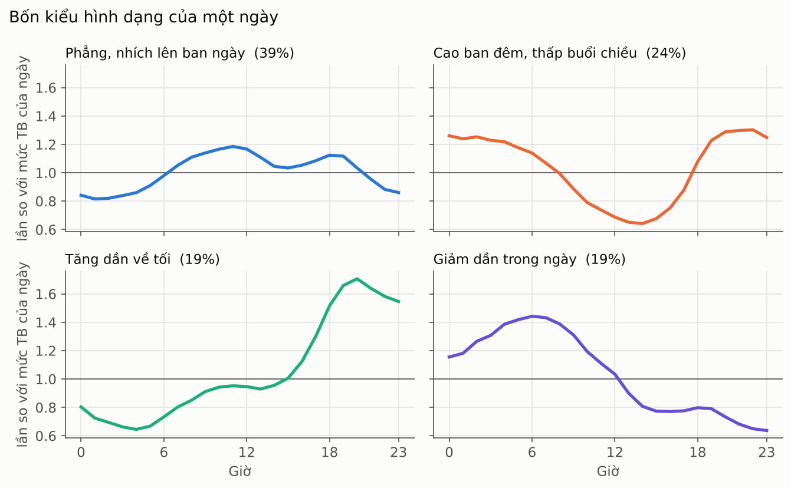

# Các kiểu ngày ô nhiễm PM2.5 ở Hà Nội và điều kiện đi kèm

Dự án tự học **data analysis + data mining** trên dữ liệu PM2.5 theo giờ của trạm Đại sứ quán Mỹ (Ba Đình), 30/01/2016 → 09/04/2025. Bản tiếng Anh đầy đủ: [README.md](README.md).

**Câu hỏi:** Ở Hà Nội có những kiểu ngày ô nhiễm nào, và mỗi kiểu thường đi kèm với điều kiện gì? Mọi kết quả là **mối liên hệ, không phải nhân quả**.

**Bài viết ngắn cho người không chuyên:** [Hà Nội có những kiểu ngày ô nhiễm nào?](article/bai_viet_vi.md) · [English version](article/article_en.md)

## Dữ liệu
- PM2.5: Bộ Ngoại giao Mỹ (AirNow DOS), lấy từ kho lưu trữ mở OpenAQ (S3). Dữ liệu của Chính phủ Mỹ, OpenAQ ghi "US Public Domain".
- Thời tiết: Open-Meteo (tái phân tích ERA5), CC BY 4.0.
- Điểm cháy: NASA FIRMS (VIIRS, MODIS), không giới hạn sử dụng, yêu cầu trích dẫn.
- Lịch: Tết, 3 đợt giãn cách Chỉ thị 16.
Ghi nguồn chi tiết: [DATA_ATTRIBUTION.md](DATA_ATTRIBUTION.md). Dữ liệu đã xử lý phát hành theo CC BY 4.0.

## Phương pháp
1. Thu thập, làm sạch, múi giờ (phase1/01–02).
2. EDA, **analysis** (phase2/03).
3. Clustering hình dạng ngày, k-means k = 4, cùng 3 bậc mức, **mining** (phase2/04).
4. Association rules FP-Growth trong từng mùa, **mining** (phase2/05).
5. Anomaly detection theo phần dư mô hình thời tiết, **mining** (phase2/06).

## Kết quả chính
- Bốn hình dạng ngày: **U** cao đêm thấp chiều (24%), **tăng dần về tối** (18%, đầu đợt ô nhiễm), **giảm dần trong ngày** (19%, cuối đợt), **phẳng** (39%).
- Mức cao đi kèm gió yếu, lớp biên thấp, khô, biên độ nhiệt lớn; mức thấp đi kèm mưa và gió mạnh (so trong cùng mùa).
- Tết thấp hơn kỳ vọng ~12%, giãn cách ~5%, cuối tuần không lệch (đối chứng âm).

## Giới hạn
Một trạm; thời tiết là tái phân tích ~25 km; điểm cháy chỉ trong Việt Nam và bị mây che; số ngày mỗi năm không đều; các ngưỡng là lựa chọn của dự án.

## Chạy lại
Xem mục *Reproduce* trong [README.md](README.md).

## Giấy phép
Code: MIT ([LICENSE](LICENSE)). Dữ liệu: CC BY 4.0 kèm ghi nguồn.
