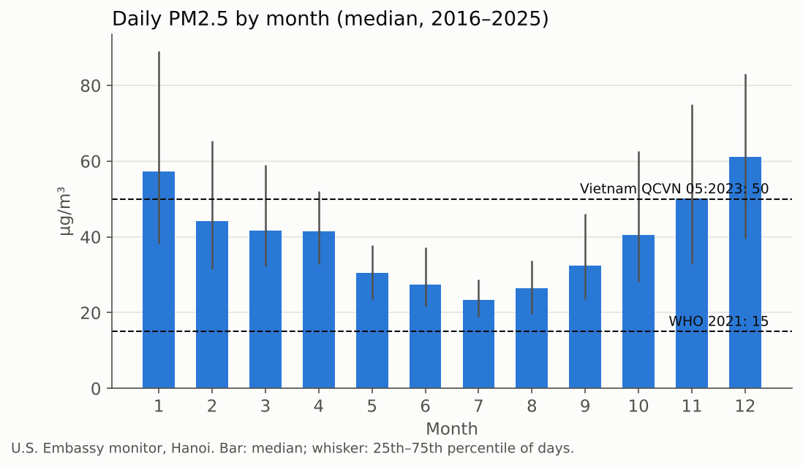
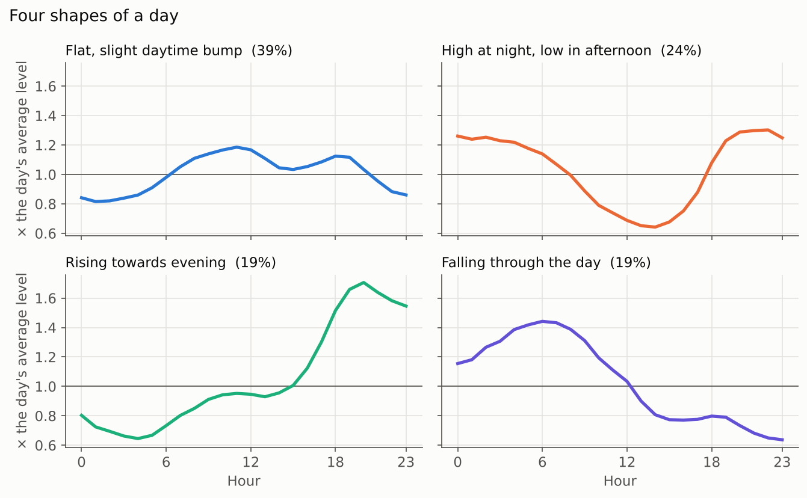
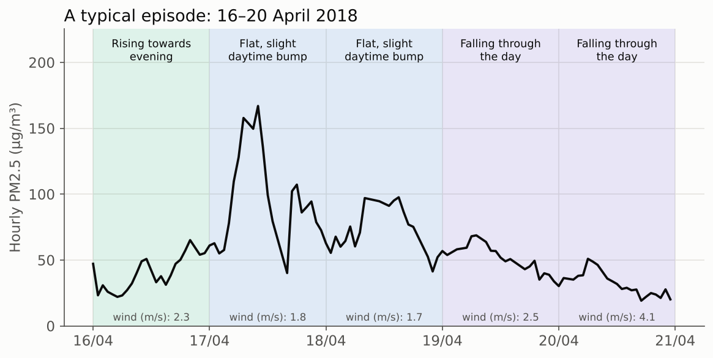
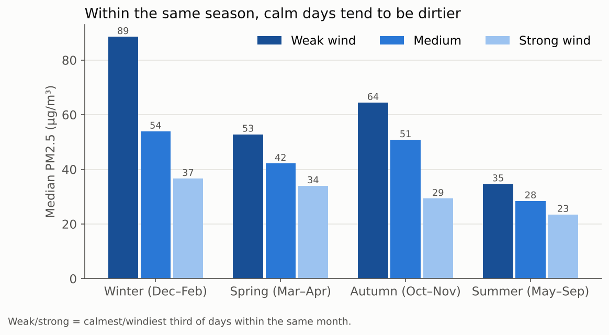

# What kinds of polluted days does Hanoi have?

*A short, non-technical write-up of a self-study data-mining project on hourly fine-particle (PM2.5) data in Hanoi, 2016–2025. Code and data: [github.com/hieuvu99/hanoi-pm25-day-types](https://github.com/hieuvu99/hanoi-pm25-day-types).*

---

**In short**

- Season matters most. In winter, more than half of all days exceed Vietnam's national limit; in summer, fewer than one in ten do.
- Looking at how pollution rises and falls over 24 hours, Hanoi's days fall into four shapes: **flat**, **high at night and low in the afternoon**, **rising towards evening**, and **falling through the day**.
- "Rising" days tend to open a pollution episode; "falling" days tend to close one.
- Within the same season, heavily polluted days tend to come with **weak wind, dry weather, no rain and a large day–night temperature swing**. These are associations, not proof of cause.

---

## What is PM2.5, and where do the numbers come from?

PM2.5 is dust smaller than 2.5 micrometres, small enough to reach deep into the lungs. It is measured in micrograms per cubic metre of air (µg/m³).

Hourly PM2.5 comes from the U.S. Embassy monitor in Ba Đình district, via the OpenAQ open-data archive. Hourly weather (wind, rain, humidity, temperature, height of the near-ground air layer) comes from ERA5 reanalysis via Open-Meteo. Fires (crop-residue and open burning) come from NASA FIRMS satellites. In total, 2,322 days have enough data.

Two reference limits, both as 24-hour averages:

- World Health Organization (WHO) 2021 guideline: **15 µg/m³**.
- Vietnam's national standard QCVN 05:2023/BTNMT: **50 µg/m³**.

Over the period, 96% of days were above the WHO guideline and 31% above the Vietnamese standard.

## 1. Season decides most of it

PM2.5 peaks from November to January and is lowest in July. A typical winter day (Dec–Feb) sits around 53 µg/m³, nearly double a typical summer day (May–Sep, about 28 µg/m³).

| Season | Typical day (µg/m³) | Days above QCVN |
|---|---|---|
| Winter (Dec–Feb) | 53 | 55% |
| Autumn (Oct–Nov) | 45 | 44% |
| Spring (Mar–Apr) | 42 | 32% |
| Summer (May–Sep) | 28 | 9% |

Because season dominates, every comparison of "conditions" below is made **within the same season**, or even the same month. Otherwise it is easy to conclude "cold weather causes pollution" when temperature is only standing in for the season.

## 2. Four shapes of a day

Two days with the same average can look very different: one is evenly hazy, the other clean in the morning and dirty at night. To find "day types", each day was split into:

- **Level**: how dirty the day is (low ≤ 25, medium 25–50, high > 50 µg/m³).
- **Shape**: how PM2.5 moves during the day relative to that day's own average.

A computer then grouped days with similar shapes (*clustering*, using k-means). Four groups were the most stable:

*Vertical axis: 1.0 is the day's average; 1.5 means 50% above that day's average.*

| Day type | Share | Usually comes with |
|---|---|---|
| **Flat, slight daytime bump** | 39% | "Ordinary" days: humid south-easterly wind, medium level; common in spring and around Lunar New Year |
| **High at night, low in afternoon** | 24% | Dry air, large temperature swing, many fires; common in Oct–Nov; often several days in a row |
| **Rising towards evening** | 19% | Evening wind weaker than morning; **the next day is typically ~32% dirtier** |
| **Falling through the day** | 19% | Evening wind picks up, south-easterly arrives; **the next day is typically ~21% cleaner** |

The night-high shape makes sense if you picture the air layer near the ground: at night it is thin and still, so dust stays trapped; in the afternoon the ground warms, air mixes and dust is diluted.

These four groups are prototypes on a continuum, not sharply separated types. Many days sit between two shapes.

## 3. How an episode usually unfolds

Lining day types up in time shows a recurring sequence: **rising → flat or night-high (dirty for days) → falling**. Here are five days in April 2018:

On 16 April PM2.5 started climbing from the afternoon into the evening. Over the next two days (17–18 April) average wind dropped below 2 m/s and hourly PM2.5 at times went above 150 µg/m³. On 19–20 April the wind strengthened (up to 4.1 m/s) and PM2.5 fell with it. Not every episode follows this script, but across all the data a "rising" day is usually followed by a dirtier day, and a "falling" day by a cleaner one.

## 4. Conditions that come with heavily polluted days

The project used *association rules* ("if conditions A and B, then usually day type C") mined separately in each season, keeping only rules that held in most years. The standout condition is **wind**:

In winter, the calmest third of days (relative to the same month) had a typical level of 89 µg/m³, versus 37 µg/m³ on the windiest third. The gap appears in all four seasons.

Combinations that tend to go together:

- **High-PM days**: weak wind, dry (no rain), low humidity, a large day–night temperature swing, a shallow near-ground air layer. For example, winter days that were both calm and had a large temperature swing were above 50 µg/m³ 95% of the time.
- **Low-PM days**: rain plus strong wind, especially south-easterly wind from the sea.
- **Fires** (crop burning) come with the night-high shape in autumn and summer, but once season is accounted for, their link to the level is weak.
- **Weekends** are no different from weekdays. **Lunar New Year** holidays are about 18% lower than normal days, and still about 12% lower once weather is accounted for. The 2021 lockdown was about 20% lower than the same period in other years, but only about 5% lower once weather is accounted for. Human activity matters, but less than weather.

A large temperature swing and a shallow air layer are signs of a **temperature inversion**: the ground cools quickly at night, creating a "lid" that holds pollution near the surface. That is a plausible explanation, but the data only show that these conditions occur together; they do not prove the mechanism.

## Caveats

- **Association, not cause.** "Weak wind comes with high PM2.5" does not make wind the source. The sources (traffic, industry, crop burning, regional transport) are always there; weather decides whether pollution builds up or is blown away.
- **One monitor.** The Ba Đình station does not represent the whole city, especially the outskirts or industrial areas.
- **Missing data.** 2019 and 2021–2023 miss several months; 2025 ends in April. Raw yearly averages are therefore not compared.
- **Weather is modelled** on a ~25 km grid, not measured on site. Fires count only those inside Vietnam and are hidden by cloud.
- Embassy data are preliminary and not fully validated. Fourteen days with suspected sensor faults were removed.

## What does this mean day to day?

A calm, dry winter day with a cold morning and a warm afternoon is a cue to check the air-quality index before going out. If pollution starts climbing in the evening and the wind is still, tomorrow is likely to be worse. A south-easterly wind or a good rain usually signals the end of an episode.

---

*Data: U.S. Department of State Air Quality Monitoring Program (U.S. Embassy Hanoi) via OpenAQ; Open-Meteo.com (CC BY 4.0), containing modified Copernicus Climate Change Service information (ERA5); NASA FIRMS. Limits: [WHO Global Air Quality Guidelines 2021](https://www.who.int/publications/i/item/9789240034228); QCVN 05:2023/BTNMT. Full methods: notebooks 03–06 in the repo's `phase2/` folder.*
