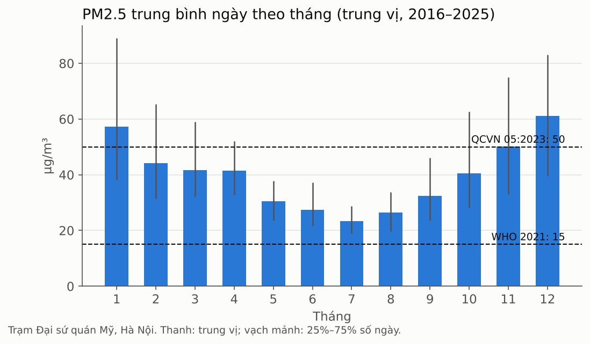
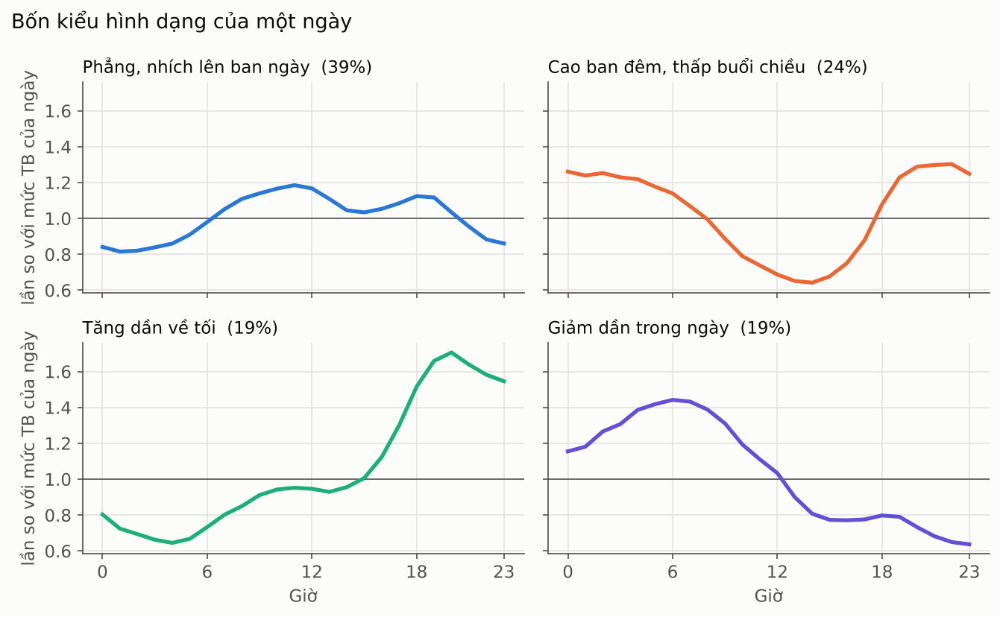
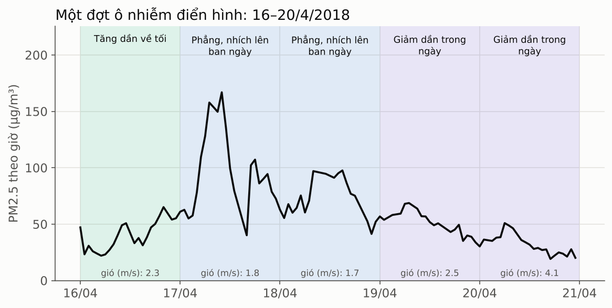
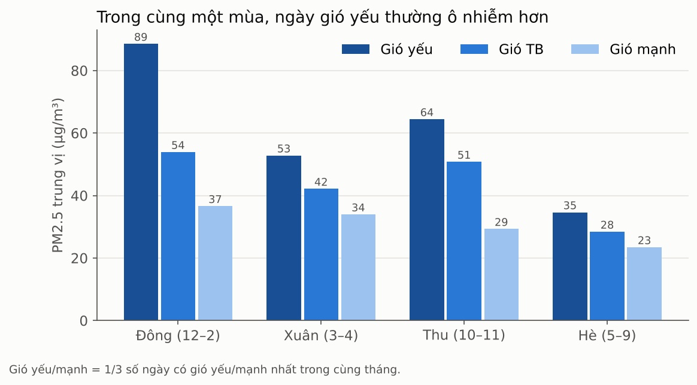

# Hà Nội có những kiểu ngày ô nhiễm nào?

*Bài viết ngắn cho người không chuyên, tóm tắt một dự án tự học data mining trên số liệu bụi mịn PM2.5 ở Hà Nội từ 2016 đến 2025. Code và dữ liệu: [github.com/hieuvu99/hanoi-pm25-day-types](https://github.com/hieuvu99/hanoi-pm25-day-types).*

---

**Tóm tắt nhanh**

- Mùa là yếu tố lớn nhất. Mùa đông, cứ hai ngày thì hơn một ngày vượt quy chuẩn Việt Nam; mùa hè chưa tới một ngày trong mười.
- Nhìn vào cách bụi lên xuống trong 24 giờ, các ngày ở Hà Nội rơi vào bốn kiểu: **phẳng**, **cao ban đêm thấp buổi chiều**, **tăng dần về tối** và **giảm dần trong ngày**.
- Ngày "tăng dần về tối" thường mở đầu một đợt ô nhiễm, ngày "giảm dần" thường kết thúc đợt đó.
- Trong cùng một mùa, ngày ô nhiễm nặng thường đi kèm **gió yếu, trời khô, ít mưa, chênh lệch nhiệt độ ngày đêm lớn**. Đây là mối liên hệ, không phải bằng chứng về nguyên nhân.

---

## PM2.5 là gì, và số liệu lấy từ đâu?

PM2.5 là bụi có đường kính nhỏ hơn 2,5 micromet, đủ nhỏ để đi sâu vào phổi. Đơn vị đo là microgam trên mét khối không khí (µg/m³).

Số liệu PM2.5 theo giờ lấy từ trạm quan trắc của Đại sứ quán Mỹ ở quận Ba Đình, qua kho dữ liệu mở OpenAQ. Thời tiết theo giờ (gió, mưa, độ ẩm, nhiệt độ, độ cao lớp không khí sát mặt đất) lấy từ dữ liệu tái phân tích ERA5 qua Open-Meteo. Điểm cháy (đốt rơm rạ, đốt mở) lấy từ vệ tinh NASA FIRMS. Tổng cộng có 2.322 ngày đủ số liệu.

Hai ngưỡng dùng để so sánh, đều tính theo trung bình 24 giờ:

- Hướng dẫn của Tổ chức Y tế Thế giới (WHO) năm 2021: **15 µg/m³**.
- Quy chuẩn Việt Nam QCVN 05:2023/BTNMT: **50 µg/m³**.

Trong giai đoạn này, 96% số ngày vượt mức của WHO và 31% số ngày vượt quy chuẩn Việt Nam.

## 1. Mùa quyết định phần lớn

Bụi mịn cao nhất từ tháng 11 đến tháng 1 và thấp nhất vào tháng 7. Ngày điển hình của mùa đông (tháng 12 đến 2) có khoảng 53 µg/m³, gần gấp đôi mùa hè (tháng 5 đến 9, khoảng 28 µg/m³). Tỷ lệ ngày vượt quy chuẩn Việt Nam theo mùa:

| Mùa | Ngày điển hình (µg/m³) | Ngày vượt QCVN |
|---|---|---|
| Đông (12–2) | 53 | 55% |
| Thu (10–11) | 45 | 44% |
| Xuân (3–4) | 42 | 32% |
| Hè (5–9) | 28 | 9% |

Vì mùa chi phối mạnh như vậy, khi tìm "điều kiện đi kèm" ở các phần sau, dự án luôn so sánh **trong cùng một mùa**, thậm chí trong cùng một tháng. Nếu không, ta dễ kết luận sai kiểu "trời lạnh gây ô nhiễm", trong khi nhiệt độ chỉ đang thay mặt cho mùa.

## 2. Bốn kiểu hình dạng của một ngày

Hai ngày có cùng mức bụi trung bình vẫn có thể rất khác nhau: một ngày bụi đều từ sáng tới tối, ngày kia sạch buổi sáng rồi tăng vọt lúc tối. Để tìm ra các "kiểu ngày", dự án tách mỗi ngày thành hai phần:

- **Mức**: ngày đó bẩn hay sạch (thấp ≤ 25, trung bình 25–50, cao > 50 µg/m³).
- **Hình dạng**: trong ngày, bụi lên xuống thế nào so với mức trung bình của chính ngày đó.

Sau đó máy tính gom những ngày có hình dạng giống nhau thành nhóm (kỹ thuật *clustering*, cụ thể là k-means). Kết quả ổn định nhất là bốn nhóm:

*Trục dọc: 1,0 là mức trung bình của ngày; 1,5 nghĩa là cao hơn 50% so với trung bình của ngày đó.*

| Kiểu ngày | Tỷ lệ | Thường gặp khi |
|---|---|---|
| **Phẳng, nhích lên ban ngày** | 39% | Ngày "bình thường": gió đông nam ẩm, mức bụi trung bình; hay gặp mùa xuân và dịp Tết |
| **Cao ban đêm, thấp buổi chiều** | 24% | Trời khô, biên độ nhiệt lớn, nhiều điểm cháy; hay gặp tháng 10–11; thường kéo dài nhiều ngày liền |
| **Tăng dần về tối** | 19% | Gió buổi tối yếu hơn buổi sáng; **hôm sau thường bẩn hơn khoảng 32%** |
| **Giảm dần trong ngày** | 19% | Gió buổi tối mạnh lên, gió đông nam về; **hôm sau thường sạch hơn khoảng 21%** |

Kiểu "cao ban đêm, thấp buổi chiều" dễ hiểu nếu nghĩ tới lớp không khí sát mặt đất: ban đêm lớp này mỏng và ít xáo trộn nên bụi bị giữ lại; buổi chiều mặt đất nóng lên, không khí xáo trộn mạnh và bụi loãng ra.

Cần nói rõ: bốn nhóm này là những "kiểu mẫu" trên một dải liên tục, không phải bốn loại tách biệt rõ ràng. Nhiều ngày nằm giữa hai kiểu.

## 3. Một đợt ô nhiễm thường diễn ra thế nào

Ghép các kiểu ngày theo thời gian, ta thấy một trình tự hay lặp lại: **tăng dần về tối → phẳng hoặc cao ban đêm (bẩn kéo dài) → giảm dần trong ngày**. Ví dụ dưới đây là năm ngày tháng 4/2018:

Ngày 16/4 bụi bắt đầu tăng từ chiều tới tối. Hai ngày tiếp theo (17–18/4) gió trung bình chỉ còn dưới 2 m/s, bụi theo giờ có lúc lên trên 150 µg/m³. Ngày 19 và 20/4 gió mạnh dần lên (tới 4,1 m/s) và bụi giảm theo. Không phải đợt nào cũng đúng khuôn này, nhưng trên toàn bộ dữ liệu, sau một ngày "tăng dần" thì ngày hôm sau thường bẩn hơn, và sau một ngày "giảm dần" thì ngày hôm sau thường sạch hơn.

## 4. Điều kiện thường đi kèm ngày ô nhiễm nặng

Dự án dùng kỹ thuật *association rules* (luật kết hợp, kiểu "nếu điều kiện A và B thì thường là kiểu ngày C") để tìm các tổ hợp điều kiện hay đi cùng nhau, trong từng mùa riêng. Chỉ giữ những luật lặp lại ở phần lớn các năm. Điều kiện nổi bật nhất là **gió**:

Trong mùa đông, ngày gió yếu nhất (1/3 số ngày lặng gió nhất của cùng tháng) có mức bụi điển hình 89 µg/m³, so với 37 µg/m³ của ngày gió mạnh. Khoảng cách này có ở cả bốn mùa.

Những tổ hợp điều kiện hay đi kèm:

- **Ngày bụi cao**: gió yếu, trời khô (không mưa), độ ẩm thấp, chênh lệch nhiệt độ ngày đêm lớn, lớp không khí sát đất thấp. Ví dụ, mùa đông, ngày vừa gió yếu vừa chênh lệch nhiệt độ lớn thì 95% là ngày vượt 50 µg/m³.
- **Ngày bụi thấp**: có mưa và gió mạnh, đặc biệt gió đông nam từ biển vào.
- **Điểm cháy** (đốt rơm rạ) đi kèm kiểu "cao ban đêm" vào mùa thu và mùa hè, nhưng sau khi trừ ảnh hưởng của mùa thì liên hệ của điểm cháy với mức bụi khá yếu.
- **Ngày cuối tuần** không khác ngày thường. **Tết** thấp hơn khoảng 18% so với ngày thường, và vẫn thấp hơn khoảng 12% sau khi đã tính đến thời tiết. Đợt giãn cách năm 2021 thấp hơn khoảng 20% so với cùng kỳ, nhưng sau khi tính đến thời tiết chỉ còn khoảng 5%. Hoạt động của người dân có góp phần, nhưng nhỏ hơn thời tiết.

Chênh lệch nhiệt độ ngày đêm lớn và lớp không khí sát đất thấp là dấu hiệu của hiện tượng **nghịch nhiệt**: ban đêm mặt đất lạnh nhanh, tạo một lớp "nắp" giữ bụi lại gần mặt đất. Đây là cách giải thích hợp lý, nhưng dữ liệu của dự án chỉ cho thấy các điều kiện này hay đi cùng nhau, chưa chứng minh được cơ chế.

## Những điều cần lưu ý

- **Mối liên hệ, không phải nguyên nhân.** "Gió yếu đi kèm bụi cao" không có nghĩa gió yếu là nguồn bụi. Nguồn bụi (xe cộ, công nghiệp, đốt rơm rạ, bụi từ vùng khác) vẫn ở đó; thời tiết chỉ quyết định bụi tích tụ hay bị thổi đi.
- **Chỉ một trạm đo.** Trạm ở Ba Đình không đại diện cho cả thành phố, nhất là vùng ven hay gần khu công nghiệp.
- **Thiếu dữ liệu.** Các năm 2019 và 2021–2023 thiếu nhiều tháng; năm 2025 chỉ có tới tháng 4. Vì vậy dự án không so sánh trung bình thô giữa các năm.
- **Thời tiết là dữ liệu mô hình hóa** trên ô lưới khoảng 25 km, không phải đo tại chỗ. Điểm cháy chỉ tính trong Việt Nam và bị mây che.
- Số liệu trạm Đại sứ quán là dữ liệu sơ bộ, chưa được kiểm định đầy đủ. Dự án đã loại 14 ngày nghi lỗi cảm biến.

## Điều này có ý nghĩa gì với người dân?

Một ngày gió yếu, trời khô, sáng lạnh trưa nóng vào mùa đông là dấu hiệu nên xem chỉ số chất lượng không khí trước khi ra ngoài. Nếu buổi tối bụi bắt đầu tăng và gió lặng, ngày hôm sau có khả năng còn bẩn hơn. Ngược lại, gió mùa đông nam hay một trận mưa thường báo hiệu đợt ô nhiễm sắp kết thúc.

---

*Nguồn dữ liệu: U.S. Department of State Air Quality Monitoring Program (Đại sứ quán Mỹ tại Hà Nội) qua OpenAQ; Open-Meteo.com (CC BY 4.0), chứa thông tin Copernicus Climate Change Service (ERA5); NASA FIRMS. Ngưỡng: [WHO Global Air Quality Guidelines 2021](https://www.who.int/publications/i/item/9789240034228); QCVN 05:2023/BTNMT. Phương pháp chi tiết: các notebook 03–06 trong thư mục `phase2/` của repo.*
